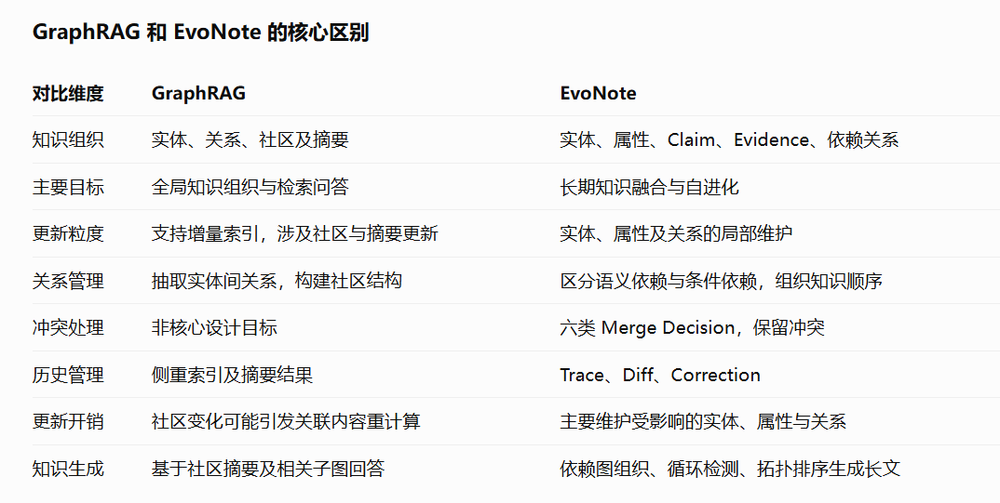
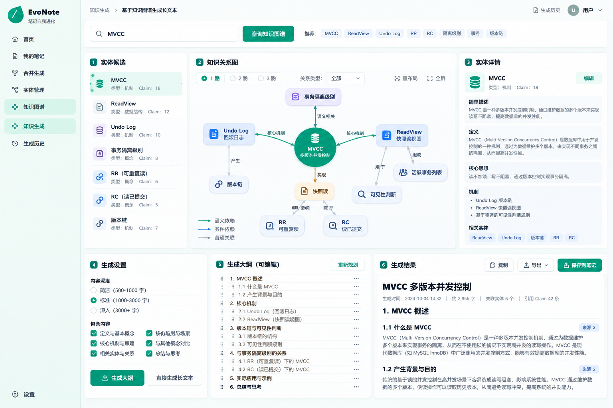
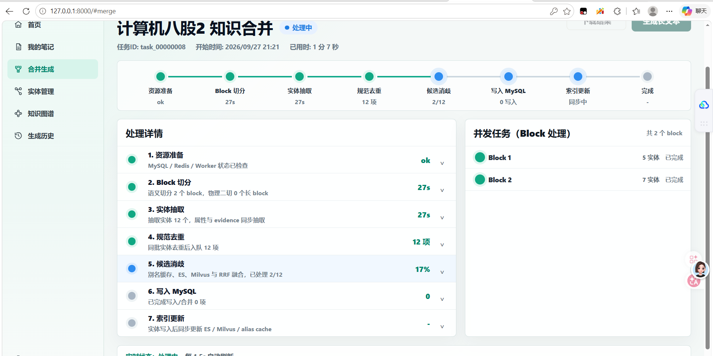

# KnowLoom｜学校规章制度知识库

**技术栈：** Python、FastAPI、MySQL、Redis、Elasticsearch、Milvus、LLM、Asyncio

KnowLoom 是面向高校规章制度的知识库原型，服务学生、辅导员、教学秘书的制度查询，以及制度管理员的文件维护与冲突审核。系统聚焦转专业、休学、学位申请、推免、奖助评定、学业预警等制度事项，以及相关机构和校内术语；它不是通用笔记系统，也不对个人是否符合某项资格作结论。

## 系统定位

学校制度常常分散在学校规定、学院细则、年度通知、修订通知和办事指南中；同一事项还可能因生效时间、学生类别、年级或学院不同而存在并行规则。KnowLoom 将这类内容按“**原文层 + 实体层**”维护：

- **原文层**保留每份制度文件及其条文，作为完整、可回看的证据来源。
- **实体层**将制度事项、机构与术语组织为可检索的属性和关系，并为属性保留证据、适用范围和历史演进信息。
- **写入时治理**优先处理版本、修订、废止与属性冲突，避免只在问答时临时拼接互相矛盾的材料。

## 能力与边界

- 维护学校及上级部门发布的规定、办法、实施细则、修订或废止通知、年度工作通知、办事指南和常见问题。
- 支持将同一制度事项在多份文件中的条件、流程、时限、材料和责任部门汇总，并为结果保留出处。
- 支持按年级、学生类别、学院等适用范围区分并存规定；旧规定不被直接删除，可保留为历史记录。
- 由制度管理员处理需要人工确认的事实性冲突和废止关系。
- 不做多条件的个人资格判定、全局总结或社区摘要，也不进行联网核验；回答仅以管理员维护的制度文件为依据。

## 当前代码基线

当前基线已经具备文本预处理、实体/属性抽取、异步入库、混合检索和结构化结果渲染能力。后续迭代会依次补齐文件原文与版本回链、制度属性槽位、冲突审核、带引用的自由问答、文件上传和条文级切分能力。

## 项目展示








## 本地启动教程

### 1. 安装 Docker Desktop

先安装 Docker Desktop，用来启动 Elasticsearch 和 Milvus。

- Windows 下载地址：https://www.docker.com/products/docker-desktop/
- 安装完成后打开 Docker Desktop，等待左下角显示 Docker Engine 已启动。
- 在终端中确认 Docker 可用：

```powershell
docker --version
docker compose version
```

### 2. 准备后端环境变量

进入后端目录：

```powershell
cd E:\huadian\knowloom\backend\python
```

如果还没有 `.env` 文件，可以从示例文件复制一份：

```powershell
copy .env.example .env
```

然后编辑 `.env`，至少确认大模型相关配置可用：

```env
AGENT_API_BASE_URL=你的模型服务地址
AGENT_API_KEY=你的 API Key
AGENT_MODEL=你的模型名

EVOLUTION_API_BASE_URL=你的模型服务地址
EVOLUTION_API_KEY=你的 API Key

EMBEDDING_MODEL=text-embedding-3-large
```

### 3. 启动 Elasticsearch 和 Milvus

回到项目根目录：

```powershell
cd E:\huadian\knowloom
```

只启动检索依赖，不启动 app 容器：

```powershell
docker compose up -d elasticsearch milvus
```

查看容器状态：

```powershell
docker compose ps
```

正常情况下能看到：

```text
knowloom-elasticsearch
knowloom-milvus
```

如果需要查看日志：

```powershell
docker compose logs -f elasticsearch
docker compose logs -f milvus
```

### 4. 安装 Python 依赖

进入后端 Python 目录：

```powershell
cd E:\huadian\knowloom\backend\python
```

创建并激活虚拟环境：

```powershell
python -m venv .venv
.\.venv\Scripts\Activate.ps1
```

安装依赖：

```powershell
pip install -r requirements.txt
```

### 5. 启动后端 main

在 `backend\python` 目录下启动：

```powershell
python app\main.py
```

也可以使用 uvicorn 热更新启动：

```powershell
uvicorn app.main:app --reload
```

启动成功后访问：

```text
http://127.0.0.1:8000/
```

API 文档：

```text
http://127.0.0.1:8000/docs
```

默认开发密码：

```text
knowloom2026
```

### 6. 停止服务

停止后端：在运行后端的终端按 `Ctrl + C`。

停止 Elasticsearch 和 Milvus：

```powershell
cd E:\huadian\knowloom
docker compose down
```

## 常用命令

重新启动 ES 和 Milvus：

```powershell
docker compose restart elasticsearch milvus
```

重建 Milvus 和 Elasticsearch 索引：

```text
POST http://127.0.0.1:8000/api/evolution/index/rebuild
```

运行 embedding 并发探测：

```powershell
cd E:\huadian\knowloom\backend\python\tests
python .\probe_embedding_concurrency.py
```

运行 embedding AB 测试：

```powershell
cd E:\huadian\knowloom\backend\python
python tests\benchmark_embedding_ab.py
```
